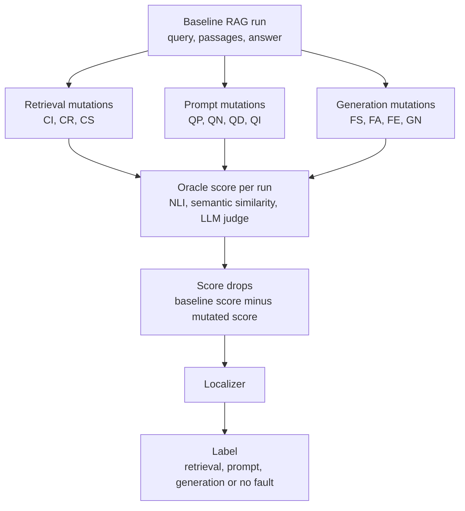

# MutOracle-RAG

[](https://github.com/m-nobinur/mutoracle-rag/actions/workflows/ci.yml)
[](pyproject.toml)
[](LICENSE)

An end-to-end RAG score tells you an answer is wrong. It does not tell you
where the pipeline went wrong, and the fix depends on that. MutOracle-RAG
takes a query and a pipeline and names the faulty stage: retrieval, prompt,
generation, or no fault.

Full write-up: <https://mnobinur.dev/work/mutoracle-rag>

## How it works

The idea comes from mutation testing. Damage one stage on purpose, score the
answer again, and see how far the score falls.



The pipeline runs once unmodified and once per operator. Each of the eleven
operators belongs to one stage:

| Stage | Operators |
| --- | --- |
| Retrieval | Context Injection (CI), Context Removal (CR), Context Shuffle (CS) |
| Prompt | Query Paraphrase (QP), Query Negation (QN), Query Detail Drop (QD), Query Instruction Injection (QI) |
| Generation | Factoid Synonym Substitution (FS), Factoid Antonym Substitution (FA), Factoid Entity Swap (FE), Answer Negation (GN) |

The oracle score mixes NLI, semantic similarity and an LLM judge, weighted
0.4, 0.3 and 0.3 by default. Some mutations cannot run, such as a paraphrase
that fails its similarity gate or a shuffle with only one passage. Those get a
zero delta and a `rejected` flag, so "ran and nothing moved" and "never ran"
are not counted as the same evidence.

## FITS dataset

FITS (fault-injection test split) has 300 examples, 75 per label, split into
60 validation and 240 test. A validator checks balance, split leakage,
stratification, checksums and a 50-example manual audit before a version is
frozen, and `v1.0.0` is frozen. The current build generates examples from
local deterministic fixtures that keep the RGB and TriviaQA schema. It does
not download the raw datasets. See [docs/FITS_DATASET.md](docs/FITS_DATASET.md).

## Results

Localization accuracy on the FITS test split: 240 examples x 3 seeds = 720
predictions (180 per label). These runs use the built-in deterministic
fixture oracles, not live LLM judges. The calibrated models were fitted on the
validation split only.

| Localizer | Overall | Retrieval | Prompt | Generation | No fault |
| --- | --- | --- | --- | --- | --- |
| Transparent max-delta rule | 30.0% | 100% | 0% | 20.0% | 0% |
| Per-stage thresholds | 40.0% | 0% | 90.0% | 0% | 70.0% |
| Nearest-centroid on 11 deltas | 86.7% | 100% | 80.0% | 76.7% | 90.0% |
| Multinomial logistic on 11 deltas | **90.0%** | 100% | 80.0% | 80.0% | 100% |

Source: [`e2_localization_calibrated_full_summary.csv`](experiments/results/e2_localization_calibrated/e2_localization_calibrated_full_summary.csv).

The transparent rule is easy to audit and badly biased. Retrieval mutations
move the oracle score much further than the others, so retrieval wins the
argmax almost every time. Per-stage thresholds moved the bias without removing
it. What worked was treating all eleven deltas as features and fitting a
small classifier. The logistic localizer gets 648 of 720 right, and all 72
errors are prompt or generation faults.

Detection asks a simpler question. Is the answer faulty at all? On the RGB
test file (not FITS), 720 predictions per method, RAGAS scores 75.0%, the
MutOracle weighted score 74.9% and a MetaRAG-style re-implementation 67.5%
([`e1_detection_full_summary.csv`](experiments/results/e1_detection/e1_detection_full_summary.csv)).
I read that as a tie with RAGAS. Neither baseline names a stage.

## Limitations

- The localization numbers come from fixture oracles. Live LLM judges may
  give different results, and they drift between model releases.
- FITS is built from local fixtures, not the raw RGB and TriviaQA downloads.
- FITS is small. With 60 test examples per label, one example moves a
  per-label score by more than a percentage point.
- The label audit was one reviewer checking 50 examples, not a multi-rater
  agreement study.
- The operators encode my assumptions about how RAG breaks. A failure mode
  with no matching operator is one the localizer cannot find.

## Quick start

```bash
uv sync --dev
uv run mutoracle config validate
make smoke
uv run pytest
```

The default path needs no credentials and runs on the fixture oracles. Live
LLM judging goes through OpenRouter when `OPENROUTER_API_KEY` is set (see
`.env.example`). Install the model-backed NLI and semantic oracles with
`uv sync --extra oracles --dev`.

| Task | Command |
| --- | --- |
| Inspect resolved config | `uv run mutoracle config show` |
| Build FITS manifests and data | `uv run mutoracle data build` |
| Run one mutation operator | `uv run mutoracle mutate --operator CI` |
| Diagnose one fixture query | `uv run mutoracle diagnose` |
| Run release checks | `uv run mutoracle release-check` |

## Documentation

- [docs/REPRODUCING.md](docs/REPRODUCING.md): clean clone to full result regeneration
- [docs/EXPERIMENTS.md](docs/EXPERIMENTS.md): E1 to E6 commands and artifact layout
- [docs/CONFIGURATION.md](docs/CONFIGURATION.md): models, aggregation and calibrated localizer settings
- [docs/MUTATION_TAXONOMY.md](docs/MUTATION_TAXONOMY.md): the eleven operators and their metadata
- [docs/ORACLE_LAYER.md](docs/ORACLE_LAYER.md): NLI, semantic-similarity and LLM-judge scoring
- [docs/FAULT_LOCALIZER.md](docs/FAULT_LOCALIZER.md): decision rule and report schema
- [docs/FITS_DATASET.md](docs/FITS_DATASET.md): FITS build, schema and quality gates
- [docs/METARAG_REIMPLEMENTATION.md](docs/METARAG_REIMPLEMENTATION.md): MetaRAG baseline notes
- [docs/API_REFERENCE.md](docs/API_REFERENCE.md): public package API

## Development

```bash
make format   # ruff format
make lint     # ruff check
make type     # mypy src/mutoracle
make test     # pytest
```

## License

MIT. See [LICENSE](LICENSE).
